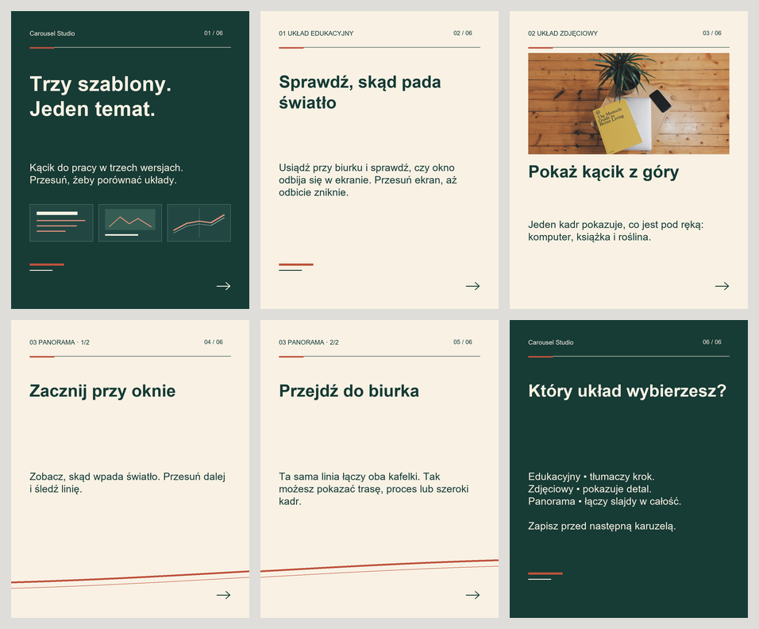
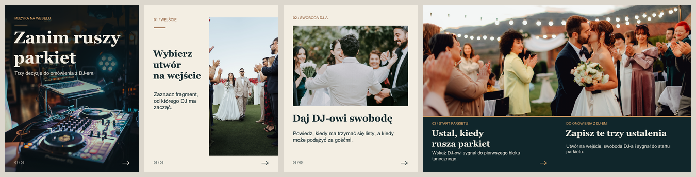
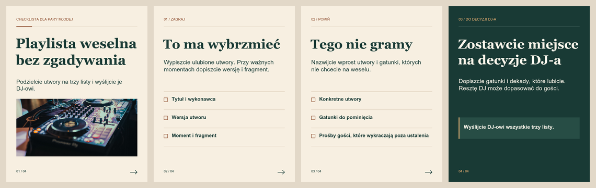
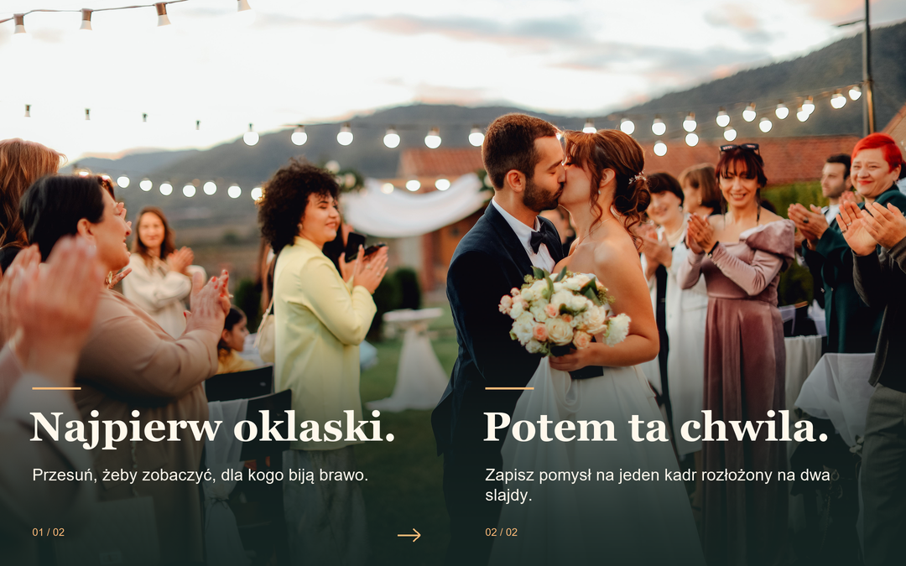

# Gotowe dema Carousel Studio

Plansze poniżej można obejrzeć na GitHubie. Aby użyć przewijania i kopiowania tekstów, pobierz i rozpakuj repozytorium, a następnie otwórz wybrany `PRZEGLAD_KARUZEL.html` w przeglądarce. Każdy ZIP zawiera slajdy PNG, edytowalne pliki SVG, planszę i teksty z opisami alternatywnymi. [Źródła zdjęć i licencje](ZRODLA_ZDJEC.md)

## Trzy szablony. Jeden temat.

Sześć slajdów porównuje układ edukacyjny, fotograficzny i panoramę na przykładzie kącika do pracy. [Podgląd HTML](szablony/PRZEGLAD_KARUZEL.html) · [Pobierz ZIP](szablony/downloads/trzy-szablony-karuzel-pakiet-v002.zip?raw=1)

## Demo weselne

Trzy karuzele ilustrowane zdjęciami stockowymi. [Podgląd całego zestawu w HTML](weselne/PRZEGLAD_KARUZEL.html) · [Pobierz wszystkie trzy paczki](weselne/downloads/demo-weselne-trzy-karuzele.zip?raw=1)

### Zanim ruszy parkiet

Pięć slajdów fotograficznych o trzech ustaleniach z DJ-em. [Podgląd HTML](weselne/fotograficzna/PRZEGLAD_KARUZEL.html) · [Pobierz ZIP](weselne/fotograficzna/downloads/demo-fotograficzne-wesele-pakiet-v001.zip?raw=1)

### Playlista weselna bez zgadywania

Cztery slajdy z trzema listami dla DJ-a. [Podgląd HTML](weselne/checklista/PRZEGLAD_KARUZEL.html) · [Pobierz ZIP](weselne/checklista/downloads/demo-checklista-weselna-pakiet-v001.zip?raw=1)

### Najpierw oklaski

Jedno pełnoformatowe zdjęcie przechodzi przez dwa slajdy. Na planszy widać oba kadry bez przerwy. [Podgląd HTML](weselne/panorama/PRZEGLAD_KARUZEL.html) · [Pobierz ZIP](weselne/panorama/downloads/demo-panorama-weselna-pakiet-v001.zip?raw=1)

